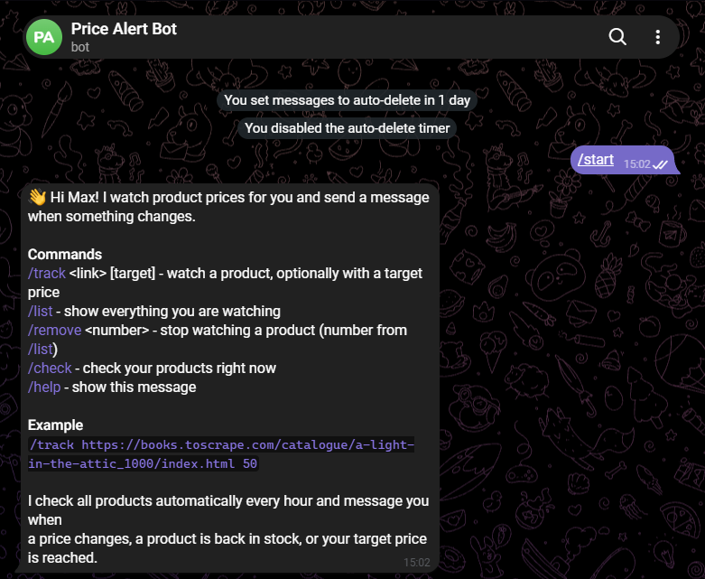
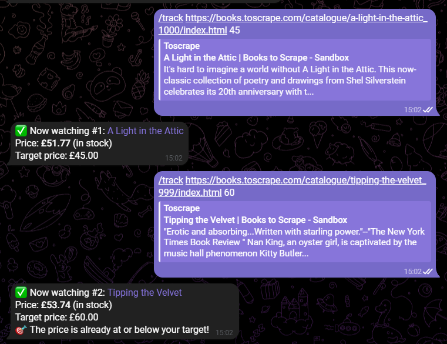
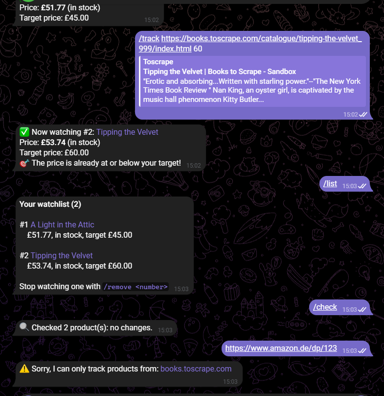

# Price Alert Bot

A Telegram bot that watches product pages and messages you when a price
drops, a product comes back in stock, or your target price is reached.
Built with `python-telegram-bot`, SQLite and a polite scraper, with 85
tests that run without internet or a real bot token.



## The problem

Checking the same shop pages every day for a price drop is boring and easy
to forget. Many small shops and resellers want exactly this kind of alert
for their own products or for competitors, delivered where they already
are: in a chat app. This bot does the checking on a schedule and only
speaks up when something actually changed.

## Features

- **Chat commands**: `/start`, `/help`, `/track <link> [target]`, `/list`,
  `/remove <number>`, `/check`. Sending a bare link works like `/track`.
- **Scheduled checks** with the JobQueue (default: every hour), every
  product page is downloaded only once per run even if many users track it.
- **Alerts** for price drops and rises, back in stock / out of stock, and
  target price reached (only once, re-armed when the price goes up again).
- **SQLite storage**: watchlists survive restarts, each chat only sees and
  removes its own items, configurable limit per chat.
- **Polite scraping** reused from my
  [book-price-scraper](https://github.com/Sossa300/book-price-scraper):
  respects robots.txt, waits between requests, retries temporary errors.
- **Robust networking**: retries failed connections, optional IPv4-only
  mode, one failed chat never stops the alerts for everyone else.
- **Configuration via `.env`**, the token is never in the code or the repo.
- **Logging and error handling**: users get a friendly message instead of
  silence, the full error goes to the log.
- **Clean architecture**: the bot logic knows nothing about Telegram, so
  it is fully testable and could move to Discord with one new file.

| Tracking with a target price | Watchlist, `/check` and an invalid link |
| --- | --- |
|  |  |

The demo tracks [books.toscrape.com](https://books.toscrape.com), a sandbox
shop made for scraping practice.

## How it works

```
Telegram  <-->  bot.py        thin layer: commands -> service, sends replies,
                              runs the scheduled check (JobQueue)
                  |
                commands.py   BotService: all decisions and reply texts
                  |      \
          storage.py    prices.py     SQLite  /  download + parse a product page
                           |
                      book_scraper/   PoliteSession (robots.txt, delay, retries)
```

`bot.py` is the only file that imports `telegram`. Blocking work (HTTP,
SQLite) runs in a worker thread with `asyncio.to_thread`, so the bot keeps
answering while a page downloads.

## Installation

Requires Python 3.10 or newer.

```bash
git clone https://github.com/Sossa300/price-alert-bot.git
cd price-alert-bot
pip install -r requirements.txt
```

### Get a bot token

1. In Telegram, open **@BotFather** (the one with the blue check mark).
2. Send `/newbot`, choose a display name, then a username ending in `bot`.
3. BotFather replies with a token like `1234567890:AAH...`. Treat it like a
   password.
4. Copy `.env.example` to `.env` and paste the token:

```bash
cp .env.example .env
```

```ini
TELEGRAM_BOT_TOKEN=1234567890:AAH...
```

`.env` is listed in `.gitignore` and must never be committed. If a token
leaks, revoke it in BotFather: `/mybots` > your bot > API Token > Revoke.

### Configuration

| Variable | Default | Meaning |
| --- | --- | --- |
| `TELEGRAM_BOT_TOKEN` | (required) | Token from @BotFather |
| `CHECK_INTERVAL_MINUTES` | `60` | How often all products are checked (min. 1) |
| `DB_PATH` | `data/alerts.db` | SQLite database file |
| `MAX_ITEMS_PER_CHAT` | `20` | Watchlist limit per chat |
| `REQUEST_DELAY` | `1.0` | Seconds between two requests to the shop |
| `LOG_LEVEL` | `INFO` | `DEBUG`, `INFO`, `WARNING` or `ERROR` |
| `FORCE_IPV4` | `false` | Set to `true` if the log shows `httpx.ConnectError` |

## Usage

```bash
python main.py
```

Stop it with `Ctrl+C`. Then talk to your bot in Telegram:

| Command | Example |
| --- | --- |
| `/track <link> [target]` | `/track https://books.toscrape.com/catalogue/a-light-in-the-attic_1000/index.html 45` |
| `/list` | shows all products with number, price, stock and target |
| `/remove <number>` | `/remove 2` |
| `/check` | checks your products right now instead of waiting |
| `/help` | list of commands |

For 24/7 operation, run `python main.py` on a small VPS or a Raspberry Pi,
for example as a systemd service.

## Adapting it for another shop or platform

| You want to ... | Change |
| --- | --- |
| track a different shop | `ALLOWED_HOSTS`, `CURRENCY` and `parse_product()` in `prices.py` |
| change when users are notified | `changes()` in `commands.py` |
| change the texts or add a command | a method in `BotService` + one `CommandHandler` in `bot.py` |
| use PostgreSQL instead of SQLite | `storage.py` (same method names) |
| build it for Discord | replace `bot.py` with a discord.py version, the rest stays |

## Tests

```bash
python -m pytest
```

85 tests cover configuration, storage, price parsing, every command,
change detection, the scheduled check and the Telegram handlers. They use
a saved product page and fake Telegram objects, so no network and no real
token are needed.

## Project structure

```
price-alert-bot/
├── main.py                 # entry point: python main.py
├── price_alert_bot/
│   ├── config.py           # settings from .env
│   ├── storage.py          # SQLite watchlist
│   ├── prices.py           # fetch + parse product pages
│   ├── commands.py         # bot logic, platform independent
│   └── bot.py              # Telegram handlers and JobQueue
├── book_scraper/           # polite fetcher, copied from book-price-scraper
├── tests/                  # pytest suite + HTML fixture
├── docs/                   # screenshots
├── .env.example
└── requirements.txt
```

## Kurzfassung auf Deutsch

Ein Telegram-Bot, der Produktseiten beobachtet und eine Nachricht schickt,
sobald sich der Preis ändert, ein Produkt wieder lieferbar ist oder ein
Zielpreis erreicht wird. Befehle: `/track`, `/list`, `/remove`, `/check`,
`/help`. Die Prüfung läuft automatisch im eingestellten Takt (JobQueue),
die Merklisten liegen in SQLite. Der Token steht nur in `.env`, die nie
committet wird. Die Bot-Logik ist von Telegram getrennt und mit 85 Tests
ohne Internet abgedeckt. Für einen anderen Shop wird nur `prices.py`
angepasst, für Discord nur `bot.py`.

## License

[MIT](LICENSE) © 2026 Sossa300
